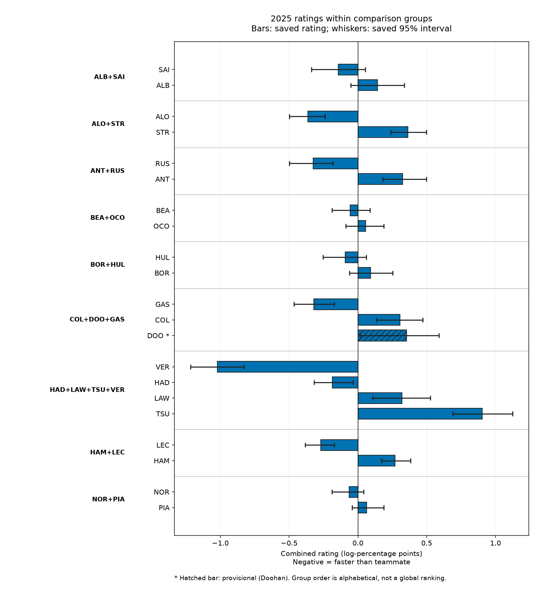
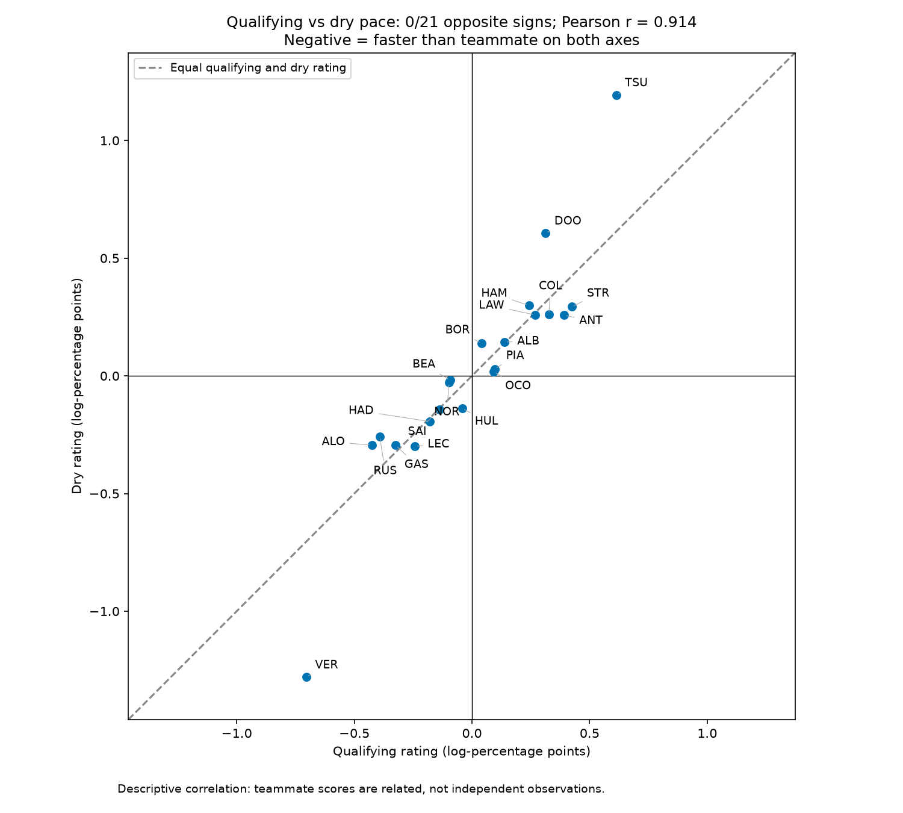
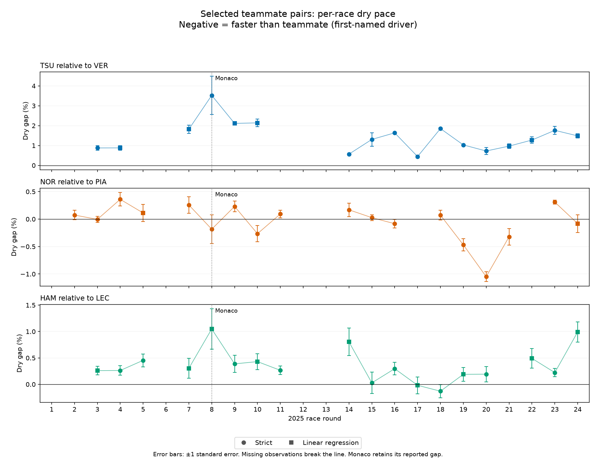
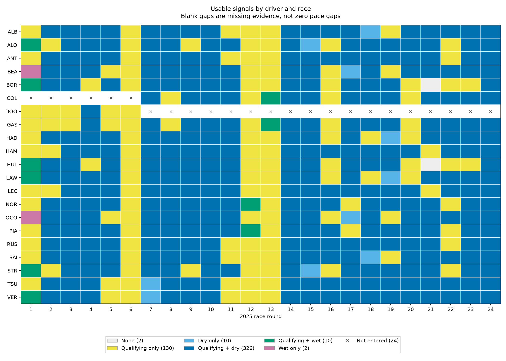

# F1 teammate pace and prediction

## What this project is

This project rates Formula 1 drivers by how they performed relative to their actual teammate in the same car, then tests whether ratings built from earlier races help predict which teammate finishes ahead. It uses qualifying, dry-race pace and wet-race pace as separate signals. It is a retrospective test of one season, not a cross-team driver ranking.



*Ratings and intervals within each comparison group; negative means faster than teammate.*

Sources: [driver-rating method](DRIVER_RATING_METHOD.md), [prediction-test method](PREDICTION_TEST_METHOD.md), [rating table](data/driver_rating_2025.csv), [chart description](SANITY_CHECKS.md).

## How to read a rating

A combined rating is in **symmetric log-percentage points**. A **negative** number means the driver was faster than their teammate; a positive number means slower. For example, Leclerc's saved combined rating is **−0.270** and Hamilton's is **+0.270** in their shared comparison group. The signs show Leclerc ahead in this teammate-relative measure; they are not predictions of a head-to-head race result or an absolute skill difference. Only drivers connected by actual teammate comparisons can be read together. The groups have no common cross-team scale, so the table below is not a grid-wide leaderboard.

For small values, one log-percentage point is approximately 1% of lap time, consistent with the method's `100 * ln(1 + gap/100)` conversion. Leclerc's −0.270 rating therefore represents about 0.27% faster pace relative to his teammate in this combined measure. For an **illustrative 80-second lap, not a measured lap**, 0.270% of 80 seconds is roughly **0.2 seconds** faster, rounded to one decimal place; this is a size illustration, not a prediction for a specific lap.

In the three- and four-driver groups (COL+DOO+GAS and HAD+LAW+TSU+VER), ratings pool each driver's gaps against their actual teammate(s), including different teammates when a change occurred, so two ratings in the same group must not be subtracted to obtain a head-to-head gap.

Sources: [driver-rating method](DRIVER_RATING_METHOD.md) (log conversion and teammate-period pooling), [rating table](data/driver_rating_2025.csv) (LEC/HAM rows and `notes`).

## Method in one screen

| Signal | Saved method |
| --- | --- |
| Qualifying | Convert each available round gap to symmetric log-percentage points, then combine Q3, Q2 and Q1 with weights **0.50 / 0.30 / 0.20**, renormalized over the rounds with valid times. |
| Dry race pace | Use a strict median gap from matched clean laps when available, then a linear regression on clean laps as the fallback. Report uncertainty using moving-block bootstrap errors. |
| Wet race pace | Match clean laps at the same lap number and tyre compound; require a start-of-lap traffic gap of at least **1.5 seconds** and apply the field-median weather-change check. |
| Season rating | Start with **45% qualifying, 45% dry pace, 10% wet pace** when fully supported; reduce each signal's weight according to its evidence factor, then renormalize. |

These are method settings, not fitted findings.

Sources: [qualifying method](QUALIFYING.md), [qualifying combination](DRIVER_RATING_METHOD.md), [dry method](METHOD_DRY_RACEPACE.md), [wet method](METHOD_WET_RACEPACE.md), [rating method](DRIVER_RATING_METHOD.md).

## 2025 results

The table keeps drivers together by their observed teammate comparison group. Values and interval endpoints are log-percentage points.

| Comparison group | Driver | Combined rating | Confidence | 95% interval |
| --- | --- | ---: | --- | ---: |
| ALB+SAI | ALB | +0.142 | high | [-0.053, +0.337] |
| ALB+SAI | SAI | -0.142 | high | [-0.337, +0.053] |
| ALO+STR | ALO | -0.364 | high | [-0.499, -0.239] |
| ALO+STR | STR | +0.364 | high | [+0.239, +0.499] |
| ANT+RUS | ANT | +0.325 | high | [+0.182, +0.499] |
| ANT+RUS | RUS | -0.325 | high | [-0.499, -0.182] |
| BEA+OCO | BEA | -0.056 | high | [-0.188, +0.088] |
| BEA+OCO | OCO | +0.056 | high | [-0.088, +0.188] |
| BOR+HUL | BOR | +0.093 | medium | [-0.061, +0.253] |
| BOR+HUL | HUL | -0.093 | medium | [-0.253, +0.061] |
| COL+DOO+GAS | COL | +0.306 | medium | [+0.136, +0.471] |
| COL+DOO+GAS | DOO | +0.355 | low/provisional | [+0.015, +0.588] |
| COL+DOO+GAS | GAS | -0.321 | medium | [-0.466, -0.171] |
| HAD+LAW+TSU+VER | HAD | -0.186 | high | [-0.319, -0.035] |
| HAD+LAW+TSU+VER | LAW | +0.321 | high | [+0.107, +0.526] |
| HAD+LAW+TSU+VER | TSU | +0.903 | high | [+0.691, +1.124] |
| HAD+LAW+TSU+VER | VER | -1.023 | high | [-1.217, -0.827] |
| HAM+LEC | HAM | +0.270 | high | [+0.172, +0.383] |
| HAM+LEC | LEC | -0.270 | high | [-0.383, -0.172] |
| NOR+PIA | NOR | -0.063 | high | [-0.189, +0.042] |
| NOR+PIA | PIA | +0.063 | high | [-0.042, +0.189] |

In COL+DOO+GAS and HAD+LAW+TSU+VER, a driver's rating pools their gaps against the teammate(s) they actually faced over the season; periods with different teammates are averaged through the existing race and signal weights, not given equal weight. There is no opponent-strength adjustment, so **do not subtract two ratings in these groups to infer a head-to-head gap**. Colapinto and Doohan each faced only Gasly; Gasly faced both. The `notes` column of `data/driver_rating_2025.csv` contains the per-teammate-period breakdowns.

Confidence labels describe coverage and usable uncertainty, not how large the gap is. Both drivers' intervals cross zero in **ALB/SAI, BEA/OCO, BOR/HUL and NOR/PIA**; the saved intervals do not establish a direction for those comparisons.



*Qualifying against dry-race rating for each driver; negative means faster than teammate on each axis.*



*Selected dry-race teammate gaps by round; negative means the first-named driver was faster.*



*Which qualifying, dry and wet signals were available for each driver-round.*

Sources: [rating table](data/driver_rating_2025.csv) (all driver rows, groups, confidence, interval and `notes` columns), [rating method](DRIVER_RATING_METHOD.md), [chart descriptions](SANITY_CHECKS.md), [qualifying gaps](data/2025_qualifying_gaps_combined.csv), [dry gaps](data/race_pace_dry_final.csv), [wet gaps](data/race_pace_wet_final.csv).

## Prediction test

The test asks whether a rating built **only from earlier rounds** adds information beyond **this weekend's qualifying** when predicting which teammate finishes ahead. M1 uses the prior rating, M2 the current qualifying gap, and M3 both. The main target includes only races where both teammates finished; the same scored pair-races are used for all methods.

The following main-target scores cover **95 pair-races across 12 scored weekends**. Brackets are **95% whole-weekend-bootstrap intervals**. Lower Brier score and log loss are better; higher accuracy is better.

| Method | Brier score [95% interval] | Accuracy [95% interval] | Log loss [95% interval] |
| --- | ---: | ---: | ---: |
| M1 · prior rating | 0.1977 [0.1711, 0.2230] | 66.3% [59.6%, 73.4%] | 0.5714 [0.5145, 0.6261] |
| M2 · current qualifying | 0.1748 [0.1501, 0.1986] | 72.6% [65.2%, 78.9%] | 0.5208 [0.4562, 0.5805] |
| M3 · both | 0.1665 [0.1391, 0.1938] | 75.8% [70.5%, 81.8%] | 0.4968 [0.4276, 0.5652] |
| Qualifying pick | 0.2029 [0.1814, 0.2280] | 72.6% [65.2%, 78.9%] | 0.5964 [0.5515, 0.6485] |
| Grid pick | 0.2030 [0.1806, 0.2273] | 72.6% [65.6%, 79.5%] | 0.5967 [0.5501, 0.6472] |
| Previous race | 0.2344 [0.2134, 0.2530] | 61.6% [55.2%, 69.3%] | 0.6617 [0.6187, 0.6999] |
| Head-to-head | 0.2078 [0.1720, 0.2442] | 65.8% [57.3%, 74.5%] | 0.5989 [0.5107, 0.6857] |
| Chance | 0.2500 [0.2500, 0.2500] | 50.0% [50.0%, 50.0%] | 0.6931 [0.6931, 0.6931] |

The prespecified M3-minus-M2 comparison uses the same scored weekends for both methods. For Brier and log loss, a negative difference favours M3; for accuracy, a positive difference favours M3.

| Metric | M3 minus M2 | 95% interval |
| --- | ---: | ---: |
| Brier score | -0.0083 | [-0.0257, +0.0083] |
| Accuracy | +3.16 percentage points | [-3.06, +10.47] percentage points |
| Log loss | -0.0240 | [-0.0621, +0.0129] |

Inconclusive, leaning positive. Adding the prior rating produced three more correct predictions out of 95 (75.8% vs 72.6%), but every interval for the improvement includes zero. One season, 12 scored weekends, exploratory.

The main target conditions on both teammates finishing, so this is **not unconditional pre-race accuracy**.

Sources: [prediction-test method](PREDICTION_TEST_METHOD.md), [saved run](data/runs/prediction_001/), [metrics.csv](data/runs/prediction_001/metrics.csv) (`main_both_finish` / `main` rows, all methods), [comparisons.csv](data/runs/prediction_001/comparisons.csv) (`main_both_finish` / `main` / `primary` / M3 versus M2, all metrics).

## Known limitations

The saved rating covers **2025 only**. It compares drivers with their actual car and teammate, so setups, upgrades, damage, tyre strategy and changes in the car can affect a score. The **21 drivers form nine disconnected teammate groups**; there is no calibrated cross-group ranking or absolute driver-quality scale. The method was designed while examining this season, and a narrow interval does not remove selection or opponent-strength bias.

Wet evidence is sparse: **6 of 30 eligible pairs** have a primary gap, and **1** is high confidence. Monaco dry gaps are retained but flagged for limited overtaking; the rating discounts their weight. Miami contributes qualifying but no dry or wet race-pace gap. Retirements have no fault classification, and the main prediction target excludes them rather than treating them as driver mistakes.

The prior rating and current qualifying feature have correlation **0.458** in the main prediction target. They are related signals, so their incremental value is harder to separate in this one-season sample. The test's retrospective earlier-round records also do not prove that every source correction was available at the time of each race.

Sources: [rating table](data/driver_rating_2025.csv), [driver-rating method, Known limitations](DRIVER_RATING_METHOD.md), [wet method, Known limitations](METHOD_WET_RACEPACE.md), [dry method, Known limitations](METHOD_DRY_RACEPACE.md), [prediction-test method](PREDICTION_TEST_METHOD.md), [prediction summary](data/runs/prediction_001/summary.json) (`feature_correlation.main_both_finish`, rounded).

## Repository guide

| Purpose | Current files |
| --- | --- |
| Data collection and result conventions | [METHOD.md](METHOD.md), race-result CSVs in [data/](data/) |
| Qualifying | [qualifying_gaps_by_round.py](qualifying_gaps_by_round.py), [qualifying_gaps_combined.py](qualifying_gaps_combined.py), [combined gaps](data/2025_qualifying_gaps_combined.csv), [QUALIFYING_BY_ROUND.md](QUALIFYING_BY_ROUND.md), [QUALIFYING.md](QUALIFYING.md) |
| Dry race pace | [race_pace_dry.py](race_pace_dry.py), [final gaps](data/race_pace_dry_final.csv), [METHOD_DRY_RACEPACE.md](METHOD_DRY_RACEPACE.md) |
| Wet race pace | [race_pace_wet.py](race_pace_wet.py), [final gaps](data/race_pace_wet_final.csv), [METHOD_WET_RACEPACE.md](METHOD_WET_RACEPACE.md) |
| Season rating | [driver_rating.py](driver_rating.py), [rating table](data/driver_rating_2025.csv), [DRIVER_RATING_METHOD.md](DRIVER_RATING_METHOD.md) |
| Prediction test | [prediction_test.py](prediction_test.py), [frozen config](prediction_test_config.json), [saved run](data/runs/prediction_001/), [PREDICTION_TEST_METHOD.md](PREDICTION_TEST_METHOD.md) |
| Inspection charts | [make_sanity_charts.py](make_sanity_charts.py), [charts/](charts/), [SANITY_CHECKS.md](SANITY_CHECKS.md) |
| Season extension — 2024 is not runnable yet | [season_config.py](season_config.py), [seasons/](seasons/), [season_parity.py](season_parity.py), [season_eligibility_audit.py](season_eligibility_audit.py), [spec](SEASON_EXTENSION_SPEC.md), [runbook](SEASON_EXTENSION_RUNBOOK.md), [parity report](SEASON_PARITY_REPORT.md), [pilot report](PILOT_2024_REPORT.md) |

The following dry-race files are **superseded research versions kept as history**, not current pipeline inputs. The superseded files are:

- **Scripts:** [`race_pace_gaps.py`](race_pace_gaps.py), [`race_pace_regression.py`](race_pace_regression.py), [`race_pace_dry_v2.py`](race_pace_dry_v2.py), [`race_pace_dry_v3.py`](race_pace_dry_v3.py).
- **Method and result documents:** [`RACEPACE.md`](RACEPACE.md), [`RACEPACE_REVIEW.md`](RACEPACE_REVIEW.md), [`RACEPACE_REGRESSION_SPEC.md`](RACEPACE_REGRESSION_SPEC.md), [`RACEPACE_REGRESSION_METHOD.md`](RACEPACE_REGRESSION_METHOD.md), [`RACEPACE_REGRESSION_RESULTS.md`](RACEPACE_REGRESSION_RESULTS.md), [`RACEPACE_DRY_V2.md`](RACEPACE_DRY_V2.md), [`RACEPACE_DRY_V3.md`](RACEPACE_DRY_V3.md).
- **Matched outputs:** [`data/2025_race_pace_teammate_gaps.csv`](data/2025_race_pace_teammate_gaps.csv), [`data/2025_race_pace_teammate_gaps_tyre_age_2.csv`](data/2025_race_pace_teammate_gaps_tyre_age_2.csv), [`data/2025_race_pace_teammate_gaps_tyre_age_5.csv`](data/2025_race_pace_teammate_gaps_tyre_age_5.csv), [`data/2025_race_pace_sensitivity_summary.csv`](data/2025_race_pace_sensitivity_summary.csv), [`data/2025_race_pace_sensitivity_pairs.csv`](data/2025_race_pace_sensitivity_pairs.csv).
- **Regression outputs:** [`data/race_pace_regression_linear.csv`](data/race_pace_regression_linear.csv), [`data/race_pace_regression_curved.csv`](data/race_pace_regression_curved.csv), [`data/race_pace_regression_comparison.csv`](data/race_pace_regression_comparison.csv).
- **Layered tables and summaries:** [`data/race_pace_dry_combined.csv`](data/race_pace_dry_combined.csv), [`data/race_pace_dry_combined_v2.csv`](data/race_pace_dry_combined_v2.csv), [`data/race_pace_dry_combined_v3.csv`](data/race_pace_dry_combined_v3.csv), [`data/race_pace_dry_v2_summary.json`](data/race_pace_dry_v2_summary.json), [`data/race_pace_dry_v3_summary.json`](data/race_pace_dry_v3_summary.json).

Sources: the files linked in the table above; [METHOD_DRY_RACEPACE.md](METHOD_DRY_RACEPACE.md), “Superseded files,” for the historical list.

## How to run

Run from the repository root with the existing `.venv`. Offline data steps use the existing FastF1 cache. Commands that write to a named folder require a **new, unused folder name** on each repeat run; the dry, wet and prediction scripts reserve numbered runs automatically. These options and output protections are defined in the linked scripts above.

Use Python **3.14.7** and the pinned library versions in [requirements.txt](requirements.txt).

```sh
.venv/bin/python qualifying_gaps_by_round.py --offline --output-dir data/runs/qualifying_readme_001
.venv/bin/python qualifying_gaps_combined.py --input data/runs/qualifying_readme_001/2025_qualifying_gaps_by_round.csv --output-dir data/runs/qualifying_readme_001
.venv/bin/python race_pace_dry.py --offline
.venv/bin/python race_pace_wet.py --offline
.venv/bin/python driver_rating.py --output-dir data/runs/driver_rating_readme_001
.venv/bin/python prediction_test.py
.venv/bin/python make_sanity_charts.py --output-dir charts_readme_001
.venv/bin/python -m unittest discover -v
```

The full offline test run on **24 October 2026** passed **141 tests with zero failures** in 9.498 seconds, using `PYTHONDONTWRITEBYTECODE=1 PYTHONPATH="$PWD/cache/_parity/offline_guard" .venv/bin/python -m unittest discover -v`.

Sources: the offline unittest run dated 24 October 2026 quoted above; [requirements](requirements.txt), [qualifying by round](qualifying_gaps_by_round.py), [qualifying combination](qualifying_gaps_combined.py), [dry script](race_pace_dry.py), [wet script](race_pace_wet.py), [rating script](driver_rating.py), [prediction script](prediction_test.py), [chart script](make_sanity_charts.py).

## Roadmap

- **Planned, not built:** Add the **2024** season through the same pipeline.
  Blocked since October 2026: F1's timing archive began rejecting unauthenticated downloads (HTTP 401), so new seasons cannot be fetched until access is resolved. 2025 data is already cached. See [PILOT_2024_REPORT.md](PILOT_2024_REPORT.md).
  The pilot confirmed this failure for Bahrain qualifying only; it did not establish when the restriction began or its archive-wide scope.
- **Planned, not built:** Build a connected career rating on a **0 to 100** scale only for drivers who can be linked across teams, and show uncertainty.
- **Planned, not built:** Freeze the evaluation specification before testing whether ratings available before a season starts predict teammate results, using **2026** as the evaluation season.

These are plans set by the project owner. None is built or tested yet.

Sources: project-owner roadmap.

## Data and credit

Race and timing data come from **FastF1** and the official timing feeds it wraps.

The code in this repository is released under the MIT License (see [LICENSE](LICENSE)). The license covers the code only. It does not grant rights to the underlying race and timing data, which come from FastF1 and the official timing feeds and remain subject to their own terms.

This is an unofficial, independent project. It is not affiliated with or endorsed by Formula 1, the FIA or any team. Formula 1 and team names are trademarks of their respective owners.

Sources: [FastF1 documentation](https://docs.fastf1.dev/), [data method](METHOD.md), [LICENSE](LICENSE).

## Roadmap and data access

The 2025 season is complete: qualifying gaps, dry and wet race-pace gaps, driver ratings, and the prediction test are saved in this repository.

The scripts support a second season through explicit season settings. Parity tests showed that the season-aware scripts reproduce the approved 2025 method and outputs exactly; no 2024 results have been produced. The 2024 session data has not been downloaded successfully. A pilot scoped to rounds 1 and 2 stopped during Bahrain qualifying after repeated HTTP 401 (unauthorized) responses from F1's timing archive. No qualifying or race session completed, so 2024 is blocked on data access. See [PILOT_2024_REPORT.md](PILOT_2024_REPORT.md) and [SEASON_PARITY_REPORT.md](SEASON_PARITY_REPORT.md).

2026 data access has not been tried.

The following steps are planned, in this order, and are not done yet:

1. Add 2024 once data access works.
2. Give each driver a per-season rating and an overall rating on a 0 to 100 scale, keeping both.
3. Test whether ratings available before a season starts can predict teammate head-to-head results, evaluated on 2026 after 2024 is done.

[requirements.txt](requirements.txt) pins the library versions.
